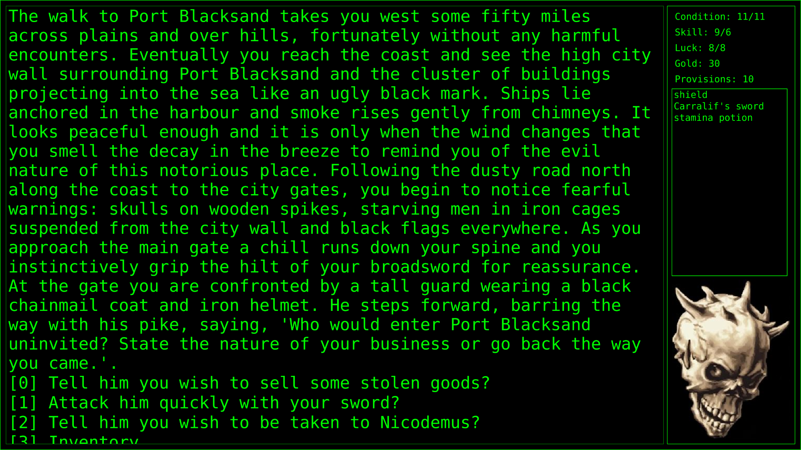

# City Of Thieves

City Of Thieves is a text adventure game after the English gamebook
with the same name by Ian Livingstone.
City Of Thieves is one of
[Richèl Bilderbeek's games](https://richelbilderbeek.github.io/games).

- [Acknowledgments](acknowledgments.md)
- [Building](build.md)
- [Contributing](CONTRIBUTING.md)
- [Download](download.md)
- [External links](external_links.md)
- [FAQ](faq.md)
- [Running](run.md)
- [Screenshots](screenshots/README.md)
- [Videos](videos.md)
- [Wikipedia](https://en.wikipedia.org/wiki/City_of_Thieves_%28gamebook%29)
